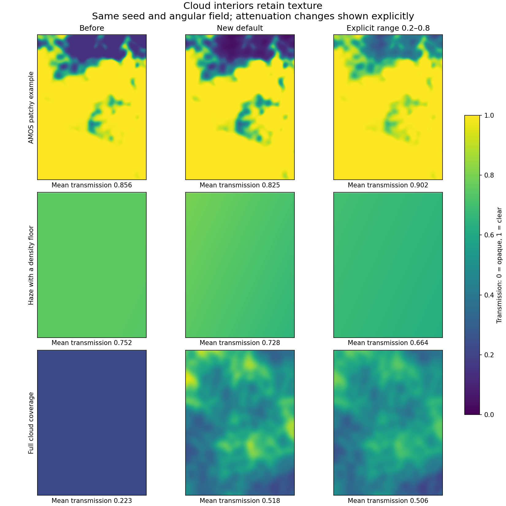
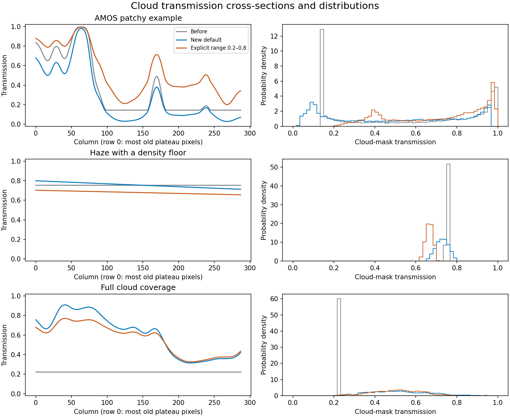

# Cloud transmission variation — v0.27.0

The new default retains the original procedural texture separately from the
coverage envelope. Saturated cloud interiors, density floors and full coverage
therefore no longer flatten the optical field. Clear sky remains exactly 1.





The white line marks the row with the most pixels at the most common old cloudy
transmission level. That plateau set may contain disconnected patches.
Statistics below use the entire field, not just that row.

## Method and behavior

Baseline: `2143a20` (merged release branch before this feature). The AMOS row uses
the archived LMNT03 patchy configuration and angular footprint recorded in
`results.json`, with a reduced 384 × 288 field for this diagnostic. It is not a
full-resolution rerender of the AMOS dataset. The other rows isolate a fog floor
and full coverage with custom 10–80 m feature scales. The original texture and
seed are identical across each row. No per-frame normalization is introduced.

“New default” retains the same tau settings. “Explicit range” replaces them with
`transmission: {"min": 0.2, "max": 0.8}`; it is a separate control example, not an
attenuation-matched comparison. Coverage envelopes reach one in interiors,
independently of coverage fraction. Mean attenuation changes are intentional
and shown below; this is a behavior change for existing configurations.

## Measurements

Flat-neighbor fraction counts horizontally adjacent mask pixels with absolute
transmission difference < 1e-7. It excludes clear-sky pairs. Plateau range uses
all locations at the most common exact transmission value within the old cloud
mask, without connected-component ranking. These tests detect lost texture,
not meteorological realism.

| Case / mode | Mean T | Mask coverage | Flat neighbors | Range on old plateau |
| --- | ---: | ---: | ---: | ---: |
| AMOS patchy example / Before | 0.8556 | 34.35% | 19.16% | 0.0000 |
| AMOS patchy example / New default | 0.8246 | 34.35% | 0.00% | 0.0905 |
| AMOS patchy example / Explicit range 0.2–0.8 | 0.9019 | 34.35% | 0.00% | 0.2277 |
| Haze with a density floor / Before | 0.7522 | 100.00% | 50.13% | 0.0000 |
| Haze with a density floor / New default | 0.7281 | 100.00% | 0.00% | 0.0707 |
| Haze with a density floor / Explicit range 0.2–0.8 | 0.6644 | 100.00% | 0.00% | 0.0379 |
| Full cloud coverage / Before | 0.2231 | 100.00% | 100.00% | 0.0000 |
| Full cloud coverage / New default | 0.5181 | 100.00% | 0.00% | 0.7281 |
| Full cloud coverage / Explicit range 0.2–0.8 | 0.5062 | 100.00% | 0.00% | 0.6000 |

## Performance

Five warmed repetitions, median elapsed time and a separate traced peak
allocation measurement. CPU functions only; no full-collect speed claim.

| Operation / mode | Median ms | Peak traced MiB |
| --- | ---: | ---: |
| 1,048,576-pixel optical mapping / old | 10.08 | 21.00 |
| 1,048,576-pixel optical mapping / default | 11.65 | 25.00 |
| 1,048,576-pixel optical mapping / bounded | 27.86 | 40.06 |
| 1024 × 1024 layer generation / old | 486.92 | 30.00 |
| 1024 × 1024 layer generation / default | 482.18 | 34.00 |
| 1024 × 1024 layer generation / bounded | 518.59 | 49.06 |
| 512 × 512 moving crop / old | 7.35 | 9.57 |
| 512 × 512 moving crop / default | 12.10 | 10.57 |
| 512 × 512 moving crop / bounded | 14.24 | 12.31 |

The retained texture adds 4 bytes per pixel per layer to source and cropped
fields (4 MiB per 1024² source layer). Traced peaks above measure allocations
inside each operation, excluding preexisting input arrays. Bounded mapping
uses float64 intermediates to keep nearly opaque endpoints stable.

## Qualification

- Parameter sweep: 120 cases passed; six types, two seeds, five coverages, two optical modes.
- full_suite: 1044 passed, 0 failures, 0 errors, 0 skipped.
- cloud_suite: 148 passed, 0 failures, 0 errors, 0 skipped.
- The focused cloud suite is a subset of the full suite; counts are not additive.
- Tests cover interior bounds, smooth edges, clear sky, constant inputs,
  equal bounds, nearly opaque endpoints, ambiguous config rejection, moving
  crops, layer stacking, glow, FFT/ePSF target flux, star flux and TIFF truth.
- Float32 bounds allow rounding tolerance. Exact zero per-layer minimum is
  rejected to keep optical depth finite; near-zero positive values are supported.
- Bounds apply to full interiors; edges blend toward clear sky and can exceed max.
  Positive-floor haze is cloudy everywhere and obeys bounds throughout the frame.
  Individual layer minima do not bound the combined stack.
- Different source-field sizes may still change original texture normalization
  and coverage quantiles; only crops of the same generated field share the map.

## Reproduce

From the repository root:

```bash
PYTHONPATH=. OPENBLAS_NUM_THREADS=1 OMP_NUM_THREADS=1 NUMBA_NUM_THREADS=1 \
  TF_NUM_INTRAOP_THREADS=1 TF_NUM_INTEROP_THREADS=1 CUDA_VISIBLE_DEVICES=-1 \
  python3 benchmarks/clouds/compare.py
```

Optionally supply `--junit` and `--targeted-junit` with freshly generated
pytest XML files to include test counts and evidence hashes. The baseline
Git history must be available. `results.json` contains exact configs, source
hashes, raw measurements and the parameter sweep. See
[usage](../../docs/usage.md#cloud-transmission-variation-v0270) for configuration.
